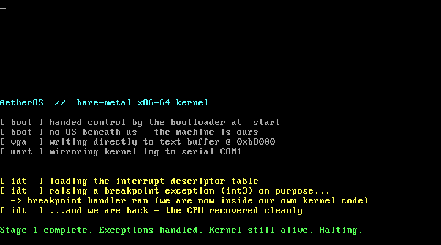

# AetherOS Kernel

A small **x86-64 operating-system kernel written from scratch in Rust** — booted on real boot infrastructure, running on bare metal with no operating system beneath it.

This is a learning-in-the-open project, built one capability at a time. The goal is not to clone Linux; it's to genuinely understand how a computer works from the moment the bootloader hands over control — and to be able to explain every layer.

> Built from the boot sector up, one commit at a time.

---

## What works so far

- [x] **Boots** — a freestanding `#![no_std]` / `#![no_main]` binary; the bootloader jumps to our `_start`.
- [x] **VGA text driver** — writes characters directly to the text buffer at physical `0xb8000`, with scrolling, colour, and `print!` / `println!` macros.
- [x] **Serial driver** — a UART 16550 (COM1) driver with `serial_println!`, mirroring the kernel log to the host so the boot can be verified headlessly.
- [x] **CPU exceptions (IDT)** — an Interrupt Descriptor Table with a breakpoint (`#BP`) handler and a double-fault handler. The kernel raises an `int3` on purpose, handles it, and resumes — the first time it survives an exception instead of triple-faulting.
- [x] **Panic handler** — a kernel-level last resort that paints the screen and halts.

### Proof it boots

Booted in QEMU — VGA output (this is a screenshot of the emulated screen):



…and the same log captured over the serial port:

```
AetherOS  //  bare-metal x86-64 kernel

[ boot ] handed control by the bootloader at _start
[ boot ] no OS beneath us - the machine is ours
[ vga  ] writing directly to text buffer @ 0xb8000
[ uart ] mirroring kernel log to serial COM1

[ idt  ] loading the interrupt descriptor table
[ idt  ] raising a breakpoint exception (int3) on purpose...
[ idt  ] breakpoint (#BP) handled at instruction 0x208471
[ idt  ] ...and we are back - the CPU recovered cleanly

Stage 1 complete. Exceptions handled. Kernel still alive. Halting.
```

## The build arc (the roadmap)

Each item is a real, independently-committable capability — built in order, roughly the classic OS-dev progression:

- [x] CPU exceptions via an Interrupt Descriptor Table (IDT)
- [ ] Hardware interrupts (PIC) + a periodic timer
- [ ] PS/2 keyboard input
- [ ] Physical memory: paging, a frame allocator
- [ ] A kernel heap + allocator (`alloc` support: `Box`, `Vec`)
- [ ] Cooperative, then preemptive, multitasking
- [ ] A tiny in-kernel shell
- [ ] A simple ramdisk / read-only filesystem

## How it boots

The kernel targets the bare-metal triple `x86_64-unknown-none` (no host OS, no SSE, red zone disabled), built **static / non-PIE** so the bootloader can load it. Rust's `build-std` compiles `core` for that target, and the [`bootloader`](https://crates.io/crates/bootloader) crate provides a BIOS bootloader that sets up long mode and jumps to `_start`. `bootimage` links the two into a single bootable disk image.

## Build & run

Requires a nightly Rust toolchain (pinned in `rust-toolchain.toml`), `bootimage`, and QEMU.

```bash
# one-time setup
rustup component add rust-src llvm-tools-preview
cargo install bootimage

# build a bootable disk image and launch it in QEMU
cargo run
```

`cargo run` builds `target/x86_64-unknown-none/debug/bootimage-aetheros_kernel.bin` and boots it in QEMU. Kernel output is mirrored to the terminal via `-serial stdio`, so the boot can be verified headlessly.

## Layout

```
src/main.rs        kernel entry point (_start) + panic handler
src/vga_buffer.rs  VGA text-mode driver and print macros
src/serial.rs      UART 16550 serial driver (host-side logging)
src/interrupts.rs  IDT + CPU exception handlers
.cargo/config.toml build-std + target + bootimage runner config
docs/              boot screenshots + devlog/ (plain-English notes per milestone)
```

## Credit & approach

The early scaffolding follows the well-trodden path of Philipp Oppermann's excellent [*Writing an OS in Rust*](https://os.phil-opp.com/). Code is heavily commented because the point is to understand it, not just run it.

---

*Built in the open, one commit at a time.*
