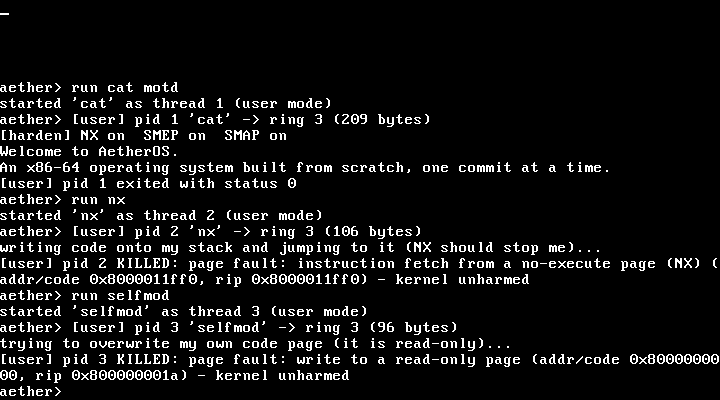

# AetherOS Kernel

A small **x86-64 operating-system kernel written from scratch in Rust** — booted on real boot infrastructure, running on bare metal with no operating system beneath it.

This is a learning-in-the-open project, built one capability at a time. The goal is not to clone Linux; it's to genuinely understand how a computer works from the moment the bootloader hands over control — and to be able to explain every layer.

> Built from the boot sector up, one commit at a time.

---

## What works so far

- [x] **Boots** — a freestanding `#![no_std]` / `#![no_main]` binary; the bootloader jumps to our `_start`.
- [x] **VGA text driver** — writes characters directly to the text buffer at physical `0xb8000`, with scrolling, colour, and `print!` / `println!` macros.
- [x] **Serial driver** — a UART 16550 (COM1) driver with `serial_println!`, mirroring the kernel log to the host so the boot can be verified headlessly.
- [x] **CPU exceptions (IDT)** — an Interrupt Descriptor Table with a breakpoint (`#BP`) handler and a double-fault handler. The kernel raises an `int3` on purpose, handles it, and resumes — the first time it survives an exception instead of triple-faulting.
- [x] **Hardware interrupts (PIC + timer)** — the 8259 PIC is remapped (vectors 32+) and interrupts are enabled; the PIT timer fires IRQ0 ~18×/sec and the kernel handles each tick (with End-Of-Interrupt) while idling in a `hlt` loop. Execution is now driven by hardware. Printing was made interrupt-safe (locks held with interrupts disabled) to avoid deadlock.
- [x] **PS/2 keyboard input** — IRQ1 is unmasked and handled; raw scancodes are read from port `0x60` and decoded (via `pc-keyboard`) into characters, which the kernel echoes to the screen. The first time the kernel reacts to *you*.
- [x] **Paging / virtual memory** — the kernel reads the active page tables (translating any virtual address to its physical frame via the recursive offset map) and **writes its own mappings**: it maps a fresh, unused virtual page onto the VGA frame and prints through it. Plus a bootloader-memory-map frame allocator. The foundation for a heap and, later, separate address spaces.
- [x] **Kernel heap** — a 512 KiB heap region is mapped and managed by a **free-list allocator written from scratch** (no external crate), registered as Rust's `#[global_allocator]`. `Box`, `Vec`, and `String` work inside the kernel, and individual blocks are reclaimed on free — allocate, free, allocate again at the same size, and it lands at the exact address just freed (`heaptest` proves it). Originally a simpler bump allocator (Stage 5); upgraded here.
- [x] **Cooperative multitasking** — an async/await `Task` type and a small round-robin executor (with a hand-built `Waker`). Two async tasks that `yield_now().await` after each step interleave on a single CPU — concurrency without threads or preemption.
- [x] **Interactive shell** — type a command, press Enter, the kernel runs it. The keyboard interrupt feeds a line buffer; commands: `help`, `echo`, `about`, `ticks`, `date`, `mem`, `ps`, `spawn`, `kill`, `run`, `exec`, `install`, `save`, `load`, `heaptest`, `cpuinfo`, `lspci`, `acpi`, `hpet`, `disk`, `clear`, `history`, fault demos `crash`/`pagefault`, and a file set `ls`, `cat`, `write`, `rm`, `cp`, `mv`. **You can drive the OS.**
- [x] **Real-time clock** — reads the battery-backed CMOS RTC over I/O ports (decoding BCD and waiting out the "update in progress" flag); `date` prints the live wall-clock time in UTC.
- [x] **CPU identification (`cpuid`)** — asks the processor to describe itself: vendor string, brand string, family/model/stepping, and feature flags (SSE, MMX, hypervisor, ...), decoded straight from the `cpuid` instruction. `cpuinfo` prints it — the same mechanism behind `lscpu`.
- [x] **PCI bus enumeration** — walks PCI configuration space over I/O ports `0xCF8`/`0xCFC` and lists what's attached: vendor/device IDs, class, and a name for recognized devices. `lspci` finds the real virtual hardware QEMU exposes (host bridge, IDE controller, VGA, NIC).
- [x] **ACPI table discovery** — searches the BIOS memory area (the EBDA, then `0xE0000..0xFFFFF`) for the RSDP signature, validates it by checksum, and reports the ACPI version and RSDT/XSDT physical addresses — then walks the RSDT/XSDT itself, checksum-validating and listing every table it names (FADT, MADT/APIC, HPET, ...), and finally **decodes the MADT's entries** to report how many CPU cores the machine actually has and where its I/O APIC lives. `acpi` prints the whole chain — genuine groundwork for future multi-core support.
- [x] **HPET (memory-mapped I/O)** — finds the HPET's base address via its ACPI table, then reads its registers directly at that physical address with ordinary memory loads (`read_volatile`) — the kernel's first hardware access that *isn't* port I/O. Enables the counter if the firmware left it off, reads it twice, and reports real elapsed nanoseconds computed from the hardware's own reported tick period. `hpet` prints it.
- [x] **A real disk (ATA PIO)** — talks to the IDE controller `lspci` found: sends IDENTIFY DEVICE to the primary master and decodes its model string and sector count, then reads sector 0 with a genuine READ SECTORS command and checks its `0x55AA` boot signature. Strictly **read-only** — no write path exists, since this disk is the very image the kernel booted from. `disk` prints it.
- [x] **Read-write in-memory filesystem (ramdisk)** — files live on the kernel heap (a `Vec<File>` with owned `String`s), so they can be **created, read, and deleted at runtime**: `ls`, `cat <file>`, `write <file> <text>`, `rm <file>`. (In-memory only — lost on reboot until there's a disk driver.)
- [x] **Memory introspection** — the allocator tracks live usage and the boot memory map is tallied for total RAM; `mem` reports heap bytes-in-use + allocation count and total usable RAM (like a tiny `free`).
- [x] **Stack-overflow hardening (GDT + TSS + IST)** — a Global Descriptor Table and Task State Segment give the double-fault handler its own **Interrupt Stack Table** stack, so a kernel stack overflow is *caught and reported* instead of escalating to a triple-fault reboot. The `crash` command proves it.
- [x] **Page-fault diagnostics** — a page-fault handler that reports the faulting virtual address (from `CR2`) and decodes the error code (read vs write, present vs protection). The `pagefault` command triggers one on an unmapped address to show it.
- [x] **Preemptive multitasking** — kernel threads switched by the timer interrupt. A hand-written `switch_context` (15 instructions of assembly) swaps callee-saved registers and stack pointers inside the timer handler; new threads start on a forged stack frame. A thread that never yields (`spawn spin`) still shares the CPU fairly. Required making the heap lock interrupt-safe (see Stage 24 for lifecycle). (Stage 6's cooperative executor is still there.)
- [x] **Thread lifecycle** — `spawn`, `ps`, `kill`, and a real blocking `sleep`. Sleeping threads cost no CPU and wake on an exact tick (a ticker thread logs every 18 ticks, precisely); `kill` frees the thread's 32 KiB stack back to the heap, never the one currently executing.
- [x] **Persistent storage** — `save` writes the filesystem to a second ATA disk (checksummed `AFS1` format, blob first / header last); the kernel restores it at boot. Corrupt or foreign disks are rejected without touching memory, and the boot disk has no write path at all.
- [x] **User mode + system calls** — ring 3 programs via `iretq`, a DPL-3 `int 0x80` gate, TSS `rsp0` kernel stack, user-only page mappings. Syscalls (`exit`/`write`/`ticks`/`getpid`/`sleep`) validate every user pointer; faulting programs (`hlt`, kernel writes) are killed without hurting the kernel, and the timer still preempts ring 3.
- [x] **Program loader** — programs are files in the filesystem (`AXE1` hex-text format, validated before running); `install` writes the built-ins out, `exec <file>` loads one into ring 3. Saved to the data disk, they survive reboot — including a 12-byte program typed by hand at the shell that exits with status 7.
- [x] **File, argument and keyboard syscalls** — ring-3 programs can `readfile`/`writefile`, receive arguments, and block on `readkey`. Kernel buffers are validated per direction (kernel-writes only into the program's stack); keys are routed to a program only while it is waiting for input.
- [x] **SYSCALL/SYSRET fast path** — EFER/STAR/LSTAR/SFMASK configured, GDT reordered to satisfy SYSRET's selector arithmetic, hand-written entry stub that swaps to the kernel stack. Both `int 0x80` and `syscall` reach the same dispatcher.
- [x] **Hardening: NX, SMEP, SMAP** — user stack is W^X (no-execute), kernel can't execute or accidentally touch user pages; all user-memory access funnelled through audited `stac`/`clac` copy helpers. Feature-detected via cpuid (verified on `-cpu max`).
- [x] **Panic handler** — a kernel-level last resort that paints the screen and halts.

### Proof it boots

Stage 30: with `-cpu max` NX/SMEP/SMAP are on; running code from the stack and overwriting a code page both kill the program with a precise reason.



From the serial log:

```
[harden] NX on  SMEP on  SMAP on
[user] pid 2 KILLED: page fault: instruction fetch from a no-execute page (NX)
```

Every stage has its own screenshot in `docs/`: [0](docs/boot-stage0.png) · [1](docs/boot-stage1.png) · [2](docs/boot-stage2.png) · [3](docs/boot-stage3.png) · [4](docs/boot-stage4.png) · [5](docs/boot-stage5.png) · [6](docs/boot-stage6.png) · [7](docs/boot-stage7.png) · [8](docs/boot-stage8.png) · [9](docs/boot-stage9.png) · [10](docs/boot-stage10.png) · [11](docs/boot-stage11.png) · [12](docs/boot-stage12.png) · [13](docs/boot-stage13.png) · [14](docs/boot-stage14.png) · [15](docs/boot-stage15.png) · [16](docs/boot-stage16.png) · [17](docs/boot-stage17.png) · [18](docs/boot-stage18.png) · [19](docs/boot-stage19.png) · [20](docs/boot-stage20.png) · [21](docs/boot-stage21.png) · [22](docs/boot-stage22.png) · [23](docs/boot-stage23.png) · [24](docs/boot-stage24.png) · [25](docs/boot-stage25.png) · [26](docs/boot-stage26.png) · [27](docs/boot-stage27.png) · [28](docs/boot-stage28.png) · [29](docs/boot-stage29.png) · [30](docs/boot-stage30.png)

## The build arc (the roadmap)

Each item is a real, independently-committable capability — built in order, roughly the classic OS-dev progression:

- [x] CPU exceptions via an Interrupt Descriptor Table (IDT)
- [x] Hardware interrupts (PIC) + a periodic timer
- [x] PS/2 keyboard input
- [x] Physical memory: paging, a frame allocator
- [x] A kernel heap + allocator (`alloc` support: `Box`, `Vec`)
- [x] Cooperative multitasking (async/await executor)
- [x] A tiny in-kernel shell
- [x] A ramdisk filesystem — now read-write (`ls`, `cat`, `write`, `rm`)
- [x] Memory introspection (`mem`: heap + RAM stats)
- [x] Richer shell: command `history`, file `cp`/`mv`
- [x] Stack-overflow hardening (GDT + TSS + double-fault IST stack)
- [x] Page-fault handler (reports faulting address + error code)
- [x] Real-time clock (CMOS RTC → `date`)
- [x] CPU identification (`cpuid` → `cpuinfo`)
- [x] PCI bus enumeration (`lspci`)
- [x] ACPI RSDP discovery, then RSDT/XSDT table walking, then MADT CPU/IOAPIC decode (`acpi`)
- [x] HPET via memory-mapped I/O — first non-port-I/O hardware access (`hpet`)
- [x] A real disk driver — ATA PIO, read-only (`disk`)
- [x] Upgraded the heap to a free-list allocator — individual blocks reclaimed, not just bump-and-reset (`heaptest`)
- [x] Preemptive multitasking — timer-driven context switching between kernel threads (`threads`)
- [x] Thread lifecycle — spawn / sleep / kill / stack reclamation (`ps`, `spawn`, `kill`)
- [x] Persistent storage — ATA write path, AFS1 on-disk format, `save` / `load` (files survive reboot)
- [x] User mode + system calls — ring 3, `int 0x80`, validated pointers, fault containment
- [x] Program loader — AXE1 programs in the filesystem, `exec`

## How it boots

The kernel targets the bare-metal triple `x86_64-unknown-none` (no host OS, no SSE, red zone disabled), built **static / non-PIE** so the bootloader can load it. Rust's `build-std` compiles `core` for that target, and the [`bootloader`](https://crates.io/crates/bootloader) crate provides a BIOS bootloader that sets up long mode and jumps to `_start`. `bootimage` links the two into a single bootable disk image.

## Build & run

Requires a nightly Rust toolchain (pinned in `rust-toolchain.toml`), `bootimage`, and QEMU.

```bash
# one-time setup
rustup component add rust-src llvm-tools-preview
cargo install bootimage

# build a bootable disk image and launch it in QEMU
cargo run
```

`cargo run` builds `target/x86_64-unknown-none/debug/bootimage-aetheros_kernel.bin` and boots it in QEMU. Kernel output is mirrored to the terminal via `-serial stdio`, so the boot can be verified headlessly.

## Layout

```
src/main.rs        kernel entry point (_start) + panic handler
src/vga_buffer.rs  VGA text-mode driver and print macros
src/serial.rs      UART 16550 serial driver (host-side logging)
src/gdt.rs         GDT + TSS with a double-fault IST stack
src/interrupts.rs  IDT, CPU exceptions, PIC, timer + keyboard handlers
src/memory.rs      paging: page-table access, translation, frame allocator
src/rtc.rs         CMOS real-time-clock reader (the `date` command)
src/cpu.rs         cpuid decoding: vendor/brand strings + feature flags
src/pci.rs         PCI config-space enumeration (the `lspci` command)
src/acpi.rs        RSDP/RSDT/XSDT/MADT discovery + decoding (`acpi` command)
src/hpet.rs         HPET via memory-mapped I/O (the `hpet` command)
src/ata.rs          ATA PIO disk access, read-only (the `disk` command)
src/allocator.rs   kernel heap region + hand-written free-list allocator
src/task/          async Task type + cooperative round-robin executor
src/shell.rs       interactive command shell (line buffer + commands)
src/fs.rs          in-memory read-write filesystem (ramdisk)
src/scheduler.rs   preemptive kernel threads: context switch, spawn, round-robin
src/persist.rs     saving / restoring the filesystem on the data disk (AFS1 format)
src/usermode.rs    ring 3: enter_user/iretq, int 0x80 syscalls, user address space, AXE1 loader
.cargo/config.toml build-std + target + bootimage runner config
docs/              boot screenshots + devlog/ (plain-English notes per milestone)
```

## Credit & approach

The early scaffolding follows the well-trodden path of Philipp Oppermann's excellent [*Writing an OS in Rust*](https://os.phil-opp.com/). Code is heavily commented because the point is to understand it, not just run it.

---

*Built in the open, one commit at a time.*
