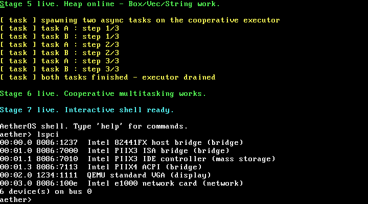

# AetherOS Kernel

A small **x86-64 operating-system kernel written from scratch in Rust** — booted on real boot infrastructure, running on bare metal with no operating system beneath it.

This is a learning-in-the-open project, built one capability at a time. The goal is not to clone Linux; it's to genuinely understand how a computer works from the moment the bootloader hands over control — and to be able to explain every layer.

> Built from the boot sector up, one commit at a time.

---

## What works so far

- [x] **Boots** — a freestanding `#![no_std]` / `#![no_main]` binary; the bootloader jumps to our `_start`.
- [x] **VGA text driver** — writes characters directly to the text buffer at physical `0xb8000`, with scrolling, colour, and `print!` / `println!` macros.
- [x] **Serial driver** — a UART 16550 (COM1) driver with `serial_println!`, mirroring the kernel log to the host so the boot can be verified headlessly.
- [x] **CPU exceptions (IDT)** — an Interrupt Descriptor Table with a breakpoint (`#BP`) handler and a double-fault handler. The kernel raises an `int3` on purpose, handles it, and resumes — the first time it survives an exception instead of triple-faulting.
- [x] **Hardware interrupts (PIC + timer)** — the 8259 PIC is remapped (vectors 32+) and interrupts are enabled; the PIT timer fires IRQ0 ~18×/sec and the kernel handles each tick (with End-Of-Interrupt) while idling in a `hlt` loop. Execution is now driven by hardware. Printing was made interrupt-safe (locks held with interrupts disabled) to avoid deadlock.
- [x] **PS/2 keyboard input** — IRQ1 is unmasked and handled; raw scancodes are read from port `0x60` and decoded (via `pc-keyboard`) into characters, which the kernel echoes to the screen. The first time the kernel reacts to *you*.
- [x] **Paging / virtual memory** — the kernel reads the active page tables (translating any virtual address to its physical frame via the recursive offset map) and **writes its own mappings**: it maps a fresh, unused virtual page onto the VGA frame and prints through it. Plus a bootloader-memory-map frame allocator. The foundation for a heap and, later, separate address spaces.
- [x] **Kernel heap** — a 100 KiB heap region is mapped and managed by a **bump allocator written from scratch** (no external crate), registered as Rust's `#[global_allocator]`. `Box`, `Vec`, and `String` now work inside the kernel.
- [x] **Cooperative multitasking** — an async/await `Task` type and a small round-robin executor (with a hand-built `Waker`). Two async tasks that `yield_now().await` after each step interleave on a single CPU — concurrency without threads or preemption.
- [x] **Interactive shell** — type a command, press Enter, the kernel runs it. The keyboard interrupt feeds a line buffer; commands: `help`, `echo`, `about`, `ticks`, `date`, `mem`, `cpuinfo`, `lspci`, `clear`, `history`, fault demos `crash`/`pagefault`, and a file set `ls`, `cat`, `write`, `rm`, `cp`, `mv`. **You can drive the OS.**
- [x] **Real-time clock** — reads the battery-backed CMOS RTC over I/O ports (decoding BCD and waiting out the "update in progress" flag); `date` prints the live wall-clock time in UTC.
- [x] **CPU identification (`cpuid`)** — asks the processor to describe itself: vendor string, brand string, family/model/stepping, and feature flags (SSE, MMX, hypervisor, ...), decoded straight from the `cpuid` instruction. `cpuinfo` prints it — the same mechanism behind `lscpu`.
- [x] **PCI bus enumeration** — walks PCI configuration space over I/O ports `0xCF8`/`0xCFC` and lists what's attached: vendor/device IDs, class, and a name for recognized devices. `lspci` finds the real virtual hardware QEMU exposes (host bridge, IDE controller, VGA, NIC).
- [x] **Read-write in-memory filesystem (ramdisk)** — files live on the kernel heap (a `Vec<File>` with owned `String`s), so they can be **created, read, and deleted at runtime**: `ls`, `cat <file>`, `write <file> <text>`, `rm <file>`. (In-memory only — lost on reboot until there's a disk driver.)
- [x] **Memory introspection** — the allocator tracks live usage and the boot memory map is tallied for total RAM; `mem` reports heap bytes-in-use + allocation count and total usable RAM (like a tiny `free`).
- [x] **Stack-overflow hardening (GDT + TSS + IST)** — a Global Descriptor Table and Task State Segment give the double-fault handler its own **Interrupt Stack Table** stack, so a kernel stack overflow is *caught and reported* instead of escalating to a triple-fault reboot. The `crash` command proves it.
- [x] **Page-fault diagnostics** — a page-fault handler that reports the faulting virtual address (from `CR2`) and decodes the error code (read vs write, present vs protection). The `pagefault` command triggers one on an unmapped address to show it.
- [x] **Panic handler** — a kernel-level last resort that paints the screen and halts.

### Proof it boots

Driving the shell interactively — `lspci` walks PCI configuration space and
finds every device QEMU's virtual chipset exposes, by name:



A tour over the serial port:

```
aether> lspci
00:00.0 8086:1237  Intel 82441FX host bridge (bridge)
00:01.0 8086:7000  Intel PIIX3 ISA bridge (bridge)
00:01.1 8086:7010  Intel PIIX3 IDE controller (mass storage)
00:01.3 8086:7113  Intel PIIX4 ACPI (bridge)
00:02.0 1234:1111  QEMU standard VGA (display)
00:03.0 8086:100e  Intel e1000 network card (network)
6 device(s) on bus 0
aether> cpuinfo
vendor: AuthenticAMD
brand:  QEMU Virtual CPU version 2.5+
family: 15  model: 11  stepping: 1
features: fpu tsc apic mmx sse sse2 sse3 hypervisor
aether> date
2026-07-14 12:29:10 UTC
aether> mem
heap: 664 / 102400 bytes in use (7 live allocations)
RAM:  126713856 bytes usable (~120 MiB)
aether> cp motd x
copied motd -> x
aether> history
  1  lspci
  2  cpuinfo
  3  date
  4  mem
  5  cp motd x
  6  history
```

The fault demos are dramatic too: `crash` overflows the stack (the double-fault
handler catches it on its IST stack instead of rebooting — `docs/boot-stage12.png`),
and `pagefault` writes to an unmapped address (the page-fault handler reports the
address + cause — `docs/boot-stage13.png`).

(Every earlier stage prints its own proof too — exceptions, the timer, paging
(a self-mapped "New!" on screen), the heap, and two async tasks interleaving.
Screenshots: `docs/boot-stage0..6.png`.)

## The build arc (the roadmap)

Each item is a real, independently-committable capability — built in order, roughly the classic OS-dev progression:

- [x] CPU exceptions via an Interrupt Descriptor Table (IDT)
- [x] Hardware interrupts (PIC) + a periodic timer
- [x] PS/2 keyboard input
- [x] Physical memory: paging, a frame allocator
- [x] A kernel heap + allocator (`alloc` support: `Box`, `Vec`)
- [x] Cooperative multitasking (async/await executor) · [ ] preemptive next
- [x] A tiny in-kernel shell
- [x] A ramdisk filesystem — now read-write (`ls`, `cat`, `write`, `rm`)
- [x] Memory introspection (`mem`: heap + RAM stats)
- [x] Richer shell: command `history`, file `cp`/`mv`
- [x] Stack-overflow hardening (GDT + TSS + double-fault IST stack)
- [x] Page-fault handler (reports faulting address + error code)
- [x] Real-time clock (CMOS RTC → `date`)
- [x] CPU identification (`cpuid` → `cpuinfo`)
- [x] PCI bus enumeration (`lspci`)
- [ ] Preemptive scheduling; a real disk-backed filesystem

## How it boots

The kernel targets the bare-metal triple `x86_64-unknown-none` (no host OS, no SSE, red zone disabled), built **static / non-PIE** so the bootloader can load it. Rust's `build-std` compiles `core` for that target, and the [`bootloader`](https://crates.io/crates/bootloader) crate provides a BIOS bootloader that sets up long mode and jumps to `_start`. `bootimage` links the two into a single bootable disk image.

## Build & run

Requires a nightly Rust toolchain (pinned in `rust-toolchain.toml`), `bootimage`, and QEMU.

```bash
# one-time setup
rustup component add rust-src llvm-tools-preview
cargo install bootimage

# build a bootable disk image and launch it in QEMU
cargo run
```

`cargo run` builds `target/x86_64-unknown-none/debug/bootimage-aetheros_kernel.bin` and boots it in QEMU. Kernel output is mirrored to the terminal via `-serial stdio`, so the boot can be verified headlessly.

## Layout

```
src/main.rs        kernel entry point (_start) + panic handler
src/vga_buffer.rs  VGA text-mode driver and print macros
src/serial.rs      UART 16550 serial driver (host-side logging)
src/gdt.rs         GDT + TSS with a double-fault IST stack
src/interrupts.rs  IDT, CPU exceptions, PIC, timer + keyboard handlers
src/memory.rs      paging: page-table access, translation, frame allocator
src/rtc.rs         CMOS real-time-clock reader (the `date` command)
src/cpu.rs         cpuid decoding: vendor/brand strings + feature flags
src/pci.rs         PCI config-space enumeration (the `lspci` command)
src/allocator.rs   kernel heap region + hand-written bump allocator
src/task/          async Task type + cooperative round-robin executor
src/shell.rs       interactive command shell (line buffer + commands)
src/fs.rs          read-only in-memory filesystem (ramdisk)
.cargo/config.toml build-std + target + bootimage runner config
docs/              boot screenshots + devlog/ (plain-English notes per milestone)
```

## Credit & approach

The early scaffolding follows the well-trodden path of Philipp Oppermann's excellent [*Writing an OS in Rust*](https://os.phil-opp.com/). Code is heavily commented because the point is to understand it, not just run it.

---

*Built in the open, one commit at a time.*
